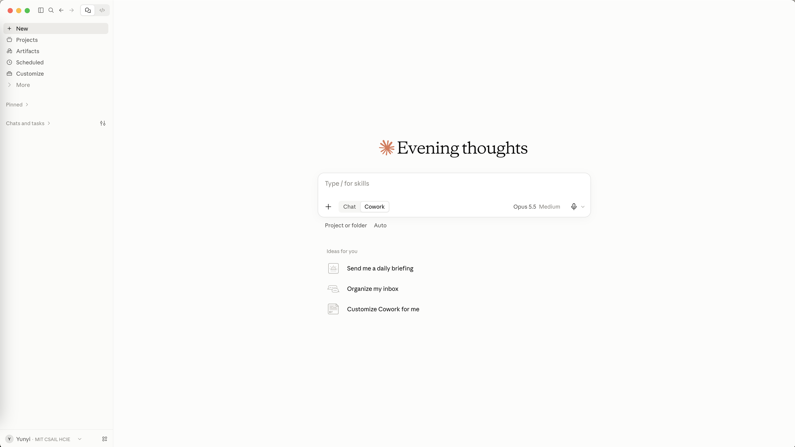
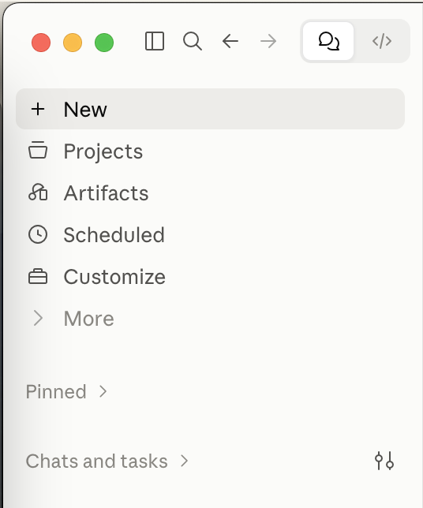
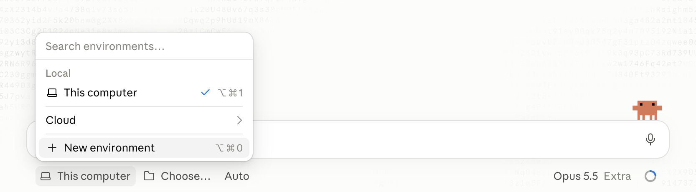
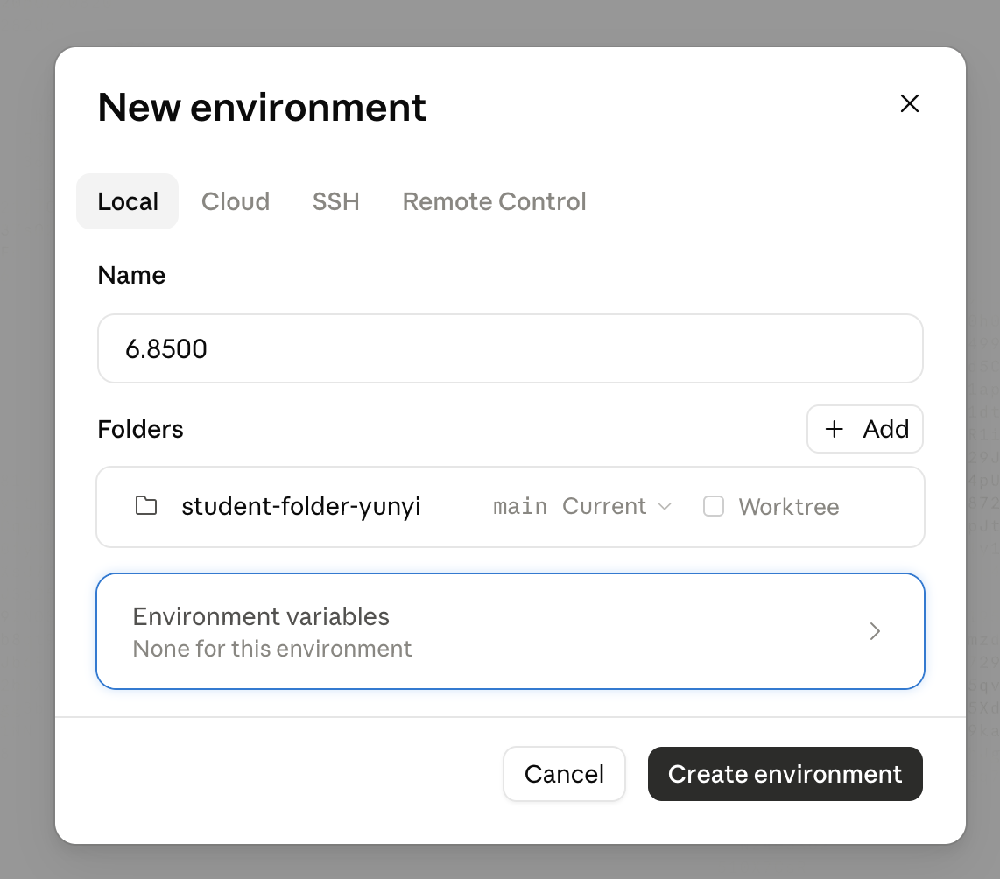

# Your working folder for 6.8500

This is the starter for your working folder, `6.8500-Interactive-Tech-Research`. You download it once, in Homework 1 (install and sign in), and keep it on your computer for the whole semester. From then on, every lab puts its files in its own folder in `labs/`, so nothing ends up scattered over your disk.

## What is inside

```
6.8500-Interactive-Tech-Research/
├── README.md          this file
├── CLAUDE.md          rules the AI reads at the start of every session in this folder
├── .gitignore         what git never backs up: your API keys, downloaded PDFs, your paper
├── .github/           the screenshots in this README
├── .claude/
│   ├── settings.json  course settings for the AI (no memory between sessions)
│   └── skills/        your skills, one folder each; the AI uses them on its own
├── homework/          one folder per homework that makes files
├── labs/              one folder per lab (map in labs/README.md)
└── psets/             the pset starters go here
```

Names that start with a dot (`.gitignore`, `.claude`) are hidden. To see them:

- **On a Mac:** in Finder, press Cmd+Shift+. (period).
- **On Windows:** in File Explorer, choose **View → Show → Hidden items**.

## Set it up (Homework 1)

1. **Download it.** Open [github.com/HCIELab/student-folder-template](https://github.com/HCIELab/student-folder-template), click the green **Code** button, and choose **Download ZIP**. You do not need a GitHub account.

2. **Unzip, rename and place it.** Unzip `student-folder-template-main.zip` (on a Mac, double-click it; on Windows, right-click it and choose **Extract All**). Rename the folder `student-folder-template-main` to `6.8500-Interactive-Tech-Research` and move it wherever you want to keep your course work, for example your Documents folder. Right inside `6.8500-Interactive-Tech-Research` you should see `README.md`, `CLAUDE.md`, `homework`, `labs` and `psets`, not another folder.

3. **Open the Code tab in the Claude app.** Check that you are in the class account: the lower left shows your name and the class organization. Then click the `</>` icon at the top left to switch from chat to code.

   

   

4. **Save your folder as an environment, once.** Under the message box, click the environment menu (**This computer**) and choose **New environment**.

   

   On the **Local** tab, name it `6.8500-Interactive-Tech-Research`. Under **Folders**, click **Add** and pick your `6.8500-Interactive-Tech-Research` folder. Leave **Worktree** unchecked, so the AI works in this folder and not in a hidden copy of it. Click **Create environment**. From now on, choose the `6.8500-Interactive-Tech-Research` environment for every session of this class.

   

5. **Check that the AI works in your folder.** Start a session in the `6.8500-Interactive-Tech-Research` environment and ask:

   ```
   Hello, what is in the folder?
   ```

   The answer looks something like this (yours will differ):

   > This is your 6.8500 working folder. At the top: README.md (how to set it up), CLAUDE.md (rules for me), .gitignore, and .claude/ with the course settings and an empty skills/ folder. Then homework/, labs/ (one folder per lab, lab01-research-areas to lab15-project-pages) and psets/. The folders are still empty apart from a .gitkeep file each.

   Then check that it works in the folder itself and knows the course rules. Ask:

   ```
   Without opening any file: what is the full path of the folder you work in,
   and which rules do you follow here?
   ```

   The answer looks something like this:

   > /Users/yourname/Documents/6.8500-Interactive-Tech-Research (on Windows: C:\Users\yourname\Documents\6.8500-Interactive-Tech-Research). I save files only in the lab folder your prompt names, never print or commit an API key, check facts about papers against a source, and leave git to you.

   You are done when the first answer lists the template's files and folders (`README.md`, `CLAUDE.md`, `homework/`, `labs/` and `psets/`), and the second gives a path that ends in `6.8500-Interactive-Tech-Research` and at least one rule, such as never printing keys.

## Rules

- **One folder per lab.** Each lab names its folder in `labs/`. Ask the AI to save its files there.
- **Keys stay private.** Never paste an API key into a chat or into a file you hand in. `.gitignore` already covers `semantic-scholar-key.txt` in case you ever put this folder under git.
- **Back it up your way.** Nothing backs this folder up for you. Use git, your computer's own backup, or both; the AI edits files here, so a way to go back to an earlier version helps. `.gitignore` already keeps your keys, downloaded PDFs and your paper out of git.
- **Your paper is separate.** `labs/lab04-uist-paper` (from Homework 2a) is its own git repository, linked to Overleaf. Overleaf keeps it.
- **`CLAUDE.md` is yours.** Add your own rules for the AI at the end of it.

| If you get stuck | Fix |
| --- | --- |
| You cannot see `.gitignore` or `.claude` | They are hidden; see above. |
| `6.8500-Interactive-Tech-Research` has only one folder in it, `student-folder-template-main` | The zip was unzipped into a folder of the same name. Move the inner folder out, delete the empty outer one, and rename the inner one to `6.8500-Interactive-Tech-Research`. |
| The app asks you to upgrade, or the lower left shows a different organization | You are in your personal account. Click your name in the lower left and choose the class organization. |
| There is no `</>` icon at the top left | Update the Claude app and restart it. |
| The AI cannot find `semantic-scholar-key.txt` | The file got a different name: `semantic-scholar-key.txt.txt` (Windows hides the second ending) or `semantic-scholar-key.rtf` (Mac TextEdit without **Make Plain Text**). Save it again as plain text with the exact name. |
| The AI says it has no access to a folder or to files | You are in the **Chat** or **Cowork** tab. Open the **Code** tab and start a **Local** session in the `6.8500-Interactive-Tech-Research` environment. |
| The AI lists files that are not from the starter, or the path ends in another folder name | The session is on a different folder. Start a new session and select `6.8500-Interactive-Tech-Research` itself, not a folder inside it. |
| The path ends in `.claude/worktrees/...`, or the AI's edits do not show up in your folder | The session was started with the worktree option on, so the AI works in a hidden copy. Start a new session in the `6.8500-Interactive-Tech-Research` environment with it off. |
| The AI cannot name any rule without opening a file | `CLAUDE.md` is missing from the top of `6.8500-Interactive-Tech-Research`. Copy it again from the starter. |
